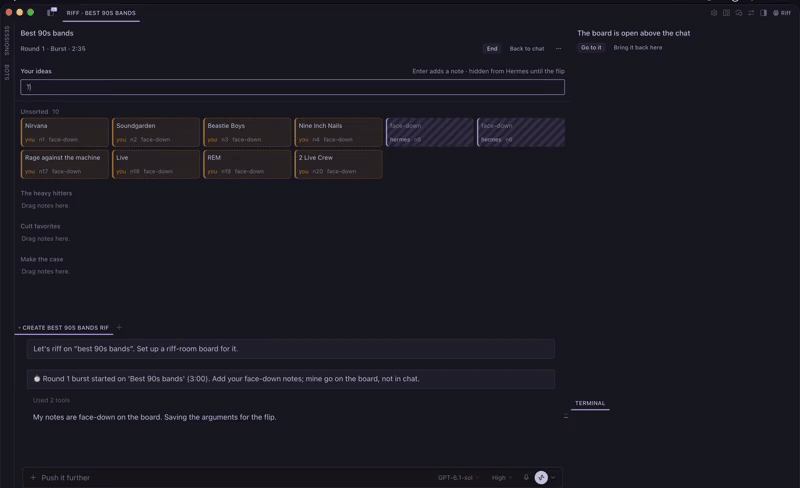
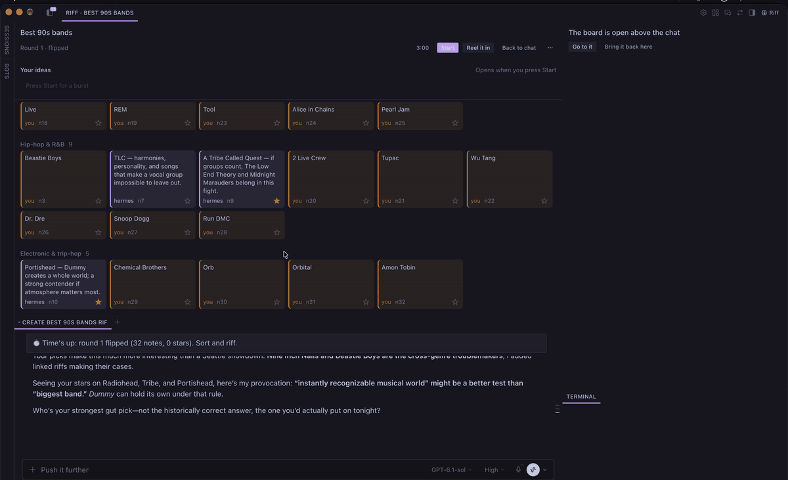
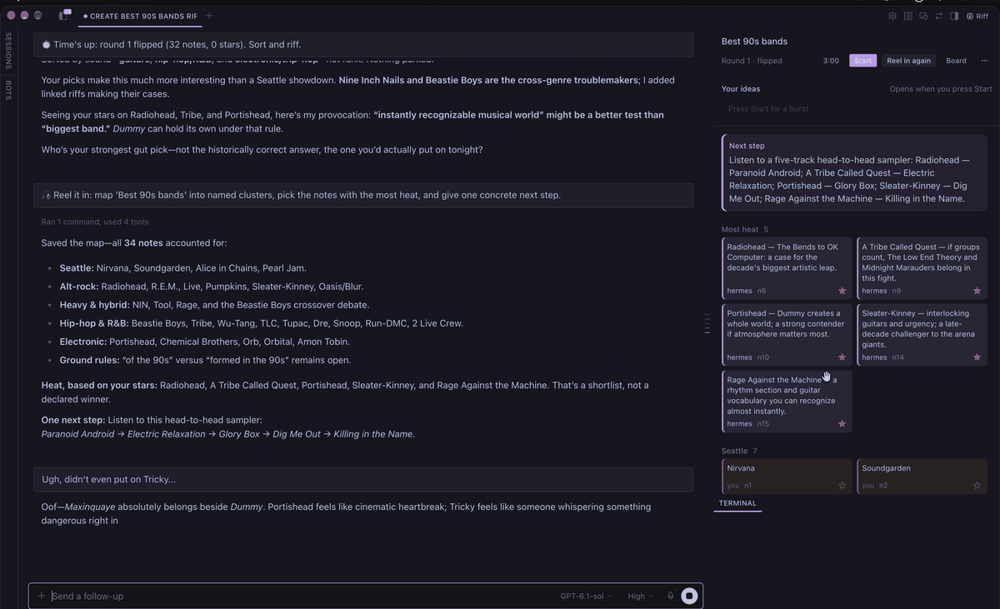

# riff-room

**Timed brainstorm rounds with Hermes as a teammate.**

[](docs/media/riff-room-demo.mp4)

Doing solo development, I miss the feeling of getting in to a brainstorm room with that pressure and excitement so I thought about instead of plan mode maybe try brainstorming.  You and Hermes both write sticky notes during a short timed burst. Notes stay face-down, so neither of you sees the other's ideas until the timer runs out. Then everything flips at once, and you sort, star and riff on what came up. When you're done, Hermes "reels it in": a map of the ideas, the ones with the most heat, and one concrete next step.

## How a round goes

1. **Open the room.** Click **Riff** in the Desktop title bar (or ⌘K → "Riff: open the brainstorm board") and name a topic. Hermes sets up a board for this chat.
2. **Burst.** Pick a length (1, 3 or 5 minutes) and press **Start**. The board moves above the chat. Type ideas into the note field, one per note, Enter to add. Hermes's card backs drop onto the board as it writes.
3. **Flip.** At time's up a chime plays and every card turns face-up.
4. **Sort and riff.** Star the ideas you like, drag them into buckets, and talk it over in chat. Hermes is told the round flipped and riffs on what came up, building on notes and parking the ones that lost energy. Run another burst whenever you want more.

   

5. **Reel it in.** Press **Reel it in**. Hermes groups the notes into named clusters, picks the hottest ones and proposes one next step. The map shows in the pane, and you can switch between the map and the board.

   

6. **Take it with you.** Export the board as Markdown. It's saved to disk and copied to your clipboard.

## Why face-down

When one person's idea lands first, everyone else starts riffing on it, and the ideas that would have come independently never show up. riff-room keeps both sides blind during a burst: the pane hides Hermes's note text from you, and the tools hide your note text from Hermes, until the flip. Critique waits for the sorting phase.

Your ideas go in the pane, not in chat. Hermes is told never to copy your chat ideas onto the board as its own, so the board stays as a record of who thought what.

## Install

Needs Hermes **0.23.0 or newer** and Hermes Desktop for the pane.

```bash
hermes plugins install dweeb11/riff-room --enable
hermes gateway restart        # the pane's backend routes load when the gateway starts
```

Then in Desktop: **Capabilities → Plugins → Rescan**, and enable **riff-room**. Look for the **Riff** button in the title bar.

## What's in the box

| Part | What it does |
| --- | --- |
| **Desktop pane** (`desktop/plugin.js`) | Launcher, burst timer with chime, face-down cards that flip, stars, drag-sort into buckets, note field, reel-in map, export. |
| **Agent tools** (6) | `riff_new_board`, `riff_add_notes`, `riff_get_board`, `riff_sort`, `riff_reel_in`, `riff_export`: how Hermes creates boards, writes notes, sorts, maps and exports. |
| **Flip hook** (`pre_llm_call`) | On Hermes's next turn after a round flips, hands it the face-up board once, so it can riff without being asked. This also covers a round that ran out with the pane closed. |
| **Backend routes** (`dashboard/plugin_api.py`) | What the pane talks to. The board lives in one store shared by the tools, routes and hook, and the timer runs on the server, so the pane and Hermes always agree on when a round ends. |

## Privacy and footprint

- No network calls, credentials or telemetry.
- Writes only under `<hermes home>/plugin-data/riff-room/` (one JSON file per board, plus Markdown exports).
- Serves `/api/plugins/riff-room/*` on the local gateway, for the pane.
- Adds a short note to Hermes's turn after a round flips (the board's summary, once per round), only in the chat the board belongs to.

## Status

Early (0.1.0). The full loop has been played end to end in Hermes Desktop on macOS: launch, burst, flip, sort, reel in, export. Other platforms are untested.

Known limits, set by what Desktop lets a plugin do:

- The board can't open in its own window. It docks above the chat during a round and goes back to the side pane afterwards (**Back to chat**).
- Desktop remembers the height you drag the chat strip to; the plugin can't set it.
- Closing riff-room's side pane disables the plugin. Re-enable it under Capabilities → Plugins.

## Develop

```bash
git clone https://github.com/dweeb11/riff-room ~/projects/riff-room
ln -s ~/projects/riff-room ~/.hermes/plugins/riff-room   # a symlinked checkout hot-reloads the pane
hermes plugins enable riff-room
hermes gateway restart
# Desktop: Capabilities → Plugins → Rescan, then enable riff-room
```

Without the symlink, Desktop runs a *copy* of `desktop/plugin.js` and keeps it until you Rescan or restart the app, so pulled pane changes won't show until then.

Checks (all must pass before committing plugin code):

```bash
hermes plugins validate . --install-deps
hermes plugins doctor . --ci
hermes --run-module unittest discover -s tests
```

`CLAUDE.md` has the rules that are easy to break (the no-anchoring view, storage, the pane's SDK limits).

## License

MIT
